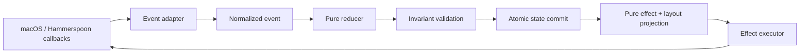
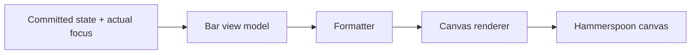

# Target Architecture

> **Status: target design, not current implementation.** See [`rewrite-plan.md`](rewrite-plan.md) for the replacement sequence and [`invariants.md`](invariants.md) for normative behavior.

## 1. Design goal

10bucks is a small, opinionated, keyboard-first tiling window manager. The MVP targets one built-in display on the current Apple Silicon corporate Mac. It should feel immediate, remain correct under asynchronous macOS events, and be easy to extend along probable seams without accumulating compatibility layers.

The central design rule is:

> Observe facts, compute one complete next state, commit it atomically, then request effects.

macOS remains authoritative for actual window focus, native Space membership, minimization, application hiding, and native fullscreen. 10bucks remains authoritative for management policy, stable stack ordering, layout state, and requested tiled frames.

## 2. Evidence and platform choice

### Verified platform facts

- The current machine runs macOS 26.x on Apple Silicon with SIP enabled.
- Hammerspoon 1.1.1 is installed and already has Accessibility access.
- Hammerspoon's `hs.spaces` module documents itself as experimental. It reads Space data with private `SLS*` APIs and creates/removes/selects Spaces through Dock Accessibility/Mission Control automation.
- `hs.spaces.gotoSpace()` waits for Mission Control Accessibility elements; its default stabilization wait is 0.3 seconds.
- Apple's public SDK exposes Accessibility observation/mutation APIs and `NSWorkspace.activeSpaceDidChangeNotification`, but no public API for creating, deleting, or selecting an arbitrary Mission Control Space.
- `hs.window.filter` is experimental and internally warns that Space-aware refreshes can call the expensive `hs.window.allWindows()` path.
- `_orderedwinids()` and `CGWindowList` onscreen results are visibility/z-order observations, not liveness.
- A live repository trace showed repeated `hs.window.get(id)` calls blocking around 1.5 seconds each in slow Accessibility applications; a reflow reached roughly 11 seconds.
- A live bar POC showed a canvas reporting visible but producing no pixels at `mainMenu` level; raising that same canvas to `overlay` made it visible.

Primary API references:

- [Hammerspoon `hs.spaces`](https://www.hammerspoon.org/docs/hs.spaces.html)
- [Hammerspoon `hs.window.filter`](https://www.hammerspoon.org/docs/hs.window.filter.html)
- [Hammerspoon `hs.canvas`](https://www.hammerspoon.org/docs/hs.canvas.html)
- Apple SDK: `AXUIElement.h`, `AXNotificationConstants.h`, `NSWorkspace.h`, `NSWindow.h`

### Platform and adapter decisions

Start with a pure-Lua core and thin Hammerspoon adapters. Do not rewrite in Swift merely because the legacy Lua is tangled: a native implementation would still use Accessibility and private/UI-automation Space mechanisms.

**Verified:** Apple's Accessibility headers document `AXUIElementDestroyed`; application termination is observable through the selected application-watcher API. **Target adapter policy:** the initial window adapter uses direct application and UI-element Accessibility events, and the reducer treats normalized destruction and application-termination observations as removal facts. A missed, delayed, contradictory, or unavailable event is uncertainty and retains the member. This is not a verified claim that either callback is reliably delivered in all cases. `hs.window.filter` is rejected as the primary lifecycle adapter because its refresh behavior is expensive/opaque and because the engine does not need it to preserve liveness safely. `_orderedwinids()`, visibility, z-order, and eligible/onscreen snapshots are not liveness evidence. There is no destructive reconciliation or permanent liveness poll.

This Target policy is a narrow engineering decision, not a claim that the broad POC-001 matrix passed. Its recorded failures and incomplete thresholds remain historical evidence in [`pocs/001-window-events-liveness.md`](pocs/001-window-events-liveness.md). Chromium and the full app matrix are deferred to ordinary slice acceptance and dogfood.

Run a minimal POC only immediately before a slice relies on an unresolved private or undocumented mechanism: Space operations before the workspace rewrite, fullscreen confirmation before fullscreen effects, and canvas handoff before the bar rewrite. If a completed slice exposes an intrinsic Hammerspoon boundary failure, POC the smallest native adapter for that boundary before considering a wholesale native rewrite.

No target approach may require disabling SIP, root access, a privileged helper, AeroSpace, or yabai.

## 3. Architectural principles

### Functional core, imperative adapters



- The reducer is the only durable-state writer.
- Projection/reflow reads committed state and an observation; it cannot decide membership or prune state.
- Effects are requested only after state commits.
- Asynchronous completions enqueue new normalized events; they never mutate state from timer callbacks.
- Hammerspoon userdata stays in adapters and an ephemeral handle cache.

### Probable extension seams without speculative implementations

Do not use YAGNI as an excuse to tangle behavior that is already likely to vary. At the same time, avoid generic frameworks for merely hypothetical features.

Required extension seams:

1. **Layouts:** more layouts are probable; stack and columns are the first two implementations of one interface.
2. **Bar:** content/formatting and canvas lifecycle/rendering are separate so status presentation can evolve.
3. **Rules:** ordered data-driven actions support future actions such as floating without app-specific engine branches.
4. **Commands:** hotkeys invoke a command registry; a CLI can be added later without moving behavior into bindings.
5. **macOS adapters:** window events/effects and Space operations are isolated because private APIs may need replacement.

Do not implement deferred features merely to populate these seams. Define only the interface needed by the two current layouts, current bar renderer/formatter, current rule actions, and current Hammerspoon adapter.

## 4. Domain model

Durable state contains plain Lua values only. A representative shape is:

```lua
ManagerState = {
  windows = {
    [windowId] = {
      id = windowId,
      application = { pid = 123, bundleID = "…", name = "…" },
      title = "…",
      ruleAction = "manage" | "nativeFullscreenOnCreate",
      lifecycle = {
        minimized = false,
        appHidden = false,
        nativeFullscreen = false,
      },
      actualDisplayId = "display-uuid",
      actualSpaceId = 1234,
      placementSpaceId = 1234, -- nil for spawn-fullscreen before normal admission
      chooserRank = 7,
    },
  },

  spaces = {
    [spaceId] = {
      id = spaceId,
      displayId = "display-uuid",
      memberIds = { ... },       -- managed membership, stable admission order
      activeLayout = "stack",
      layouts = {
        stack = { ... },         -- layout-owned state
        columns = { ... },       -- retained while inactive
      },
    },
  },

  focus = {
    actualWindow = { id = 99, title = "Popup", applicationName = "…" },
    managedHistory = { ... },
  },

  displays = {
    [displayId] = {
      activeRegularSpaceId = 1234,
      previousRegularSpaceId = 5678,
    },
  },
}
```

The exact representation should remain as small as the reducer permits. It must preserve these distinctions:

```text
alive ≠ visible ≠ onscreen ≠ in active Space ≠ available to j/k
```

Lifecycle conditions are independent observations, not one mutually exclusive enum. For example, a minimized window may also belong to a hidden application. Availability is derived: a managed member is available to tile/navigate only when no condition makes it unavailable.

### Durable versus observed data

Durable:

- managed identity and metadata required by rules/chooser
- explicit display identity plus confirmed actual Space and optional saved placement Space
- independent minimized/app-hidden/native-fullscreen conditions and derived availability
- per-Space membership and active layout
- layout-owned stable order, grouping, selection, and divider
- managed focus history
- current/previous confirmed regular desktop

Ephemeral adapter data:

- `hs.window` objects and AX elements
- canvas/chooser/watcher/timer objects
- actual last-applied frames
- in-flight native operation handles and bounded retry timers
- one transaction's observation snapshot

### Liveness

Under the **Target adapter policy**, a window leaves durable state only after the reducer receives a selected removal observation:

- normalized direct UI-element destruction (`AXUIElementDestroyed`)
- normalized owning-application termination
- a targeted native membership/liveness query only when a future slice has proved that specific query necessary and non-destructive

The first two are policy-selected removal inputs, not a POC-verified callback-reliability guarantee.

Absence from onscreen, visible, eligible, focused, or one AX snapshot is not evidence of death. If liveness is uncertain—including a missed direct event—retaining a stale entry is safer than deleting a live stack member.

## 5. Normalized events and transactions

Candidate normalized events include:

```text
WindowReady
WindowDestroyed
WindowMinimized
WindowRestored
ApplicationHidden
ApplicationUnhidden
WindowEnteredNativeFullscreen
WindowExitedNativeFullscreen
WindowMovedToRegularSpace
ActualFocusChanged
WindowTitleChanged
RegularSpaceActivated
RegularSpaceRemoved
CommandRequested
NativeOperationCompleted
NativeOperationFailed
```

The event adapter must attach the facts the reducer needs—IDs, confirmed Space, metadata, and availability—without making the reducer query Hammerspoon.

Transaction algorithm:

1. Receive one normalized event or command.
2. Reduce current state to a complete candidate state.
3. Validate invariants in tests/development builds.
4. Commit once.
5. Derive frame, focus, bar, fullscreen, and Space-operation intents.
6. Deduplicate intents against the current observation/last applied effects.
7. Execute effects.
8. Treat later OS callbacks as new observations.

Hammerspoon already invokes Lua callbacks serially on its main thread. The design must keep them short rather than introduce parallel mutation.

### Async operations

Space switching/creation/deletion and native fullscreen are asynchronous transactions. Each gets a generation/token. A completion or timeout is accepted only for the current token and expected source/destination. Bounded retry timers are allowed; permanent polling is not.

Keyboard concurrency is explicit:

| Command class | While an effect is pending |
|---|---|
| Stack/group focus (`j/k/h/l`) | Every keypress updates committed desired selection; only the newest focus request remains authoritative. |
| Relative desktop focus (`n/p`) | Advance from the pending desired destination, not the last confirmed desktop. Thus `n,n` from 1 desires 3 and `n,p` desires 1. Native switching remains serialized and intermediate destinations coalesce. |
| Numbered desktop focus | Replace the pending desired destination with that absolute existing position. |
| Previous regular desktop (`0`) | Resolve from confirmed regular-desktop history; repeated invocation before confirmation targets the same previous desktop. Native switching remains serialized. |
| Chooser/previous-window focus | The latest explicit target wins. Repeated previous-window before actual focus confirmation resolves from unchanged actual history and therefore targets the same previous window. |
| Create/delete Space | Reject another structural mutation and any command that would change regular Space until completion/failure. Same-Space layout/focus commands remain available. |
| Toggle fullscreen for the same target | Reject another toggle until completion/failure. |
| Layout/frame-only command | Reduce synchronously against committed desired state. |

A timeout clears the intent, resnapshots the relevant actual state, and reports failure. A late OS change is normalized as external reality, not accepted as completion of the expired token. A stale intermediate focus callback may update actual-focus presentation, but MUST NOT replace a newer desired managed selection; once the latest request succeeds or times out, actual focus reconciles selection.

`ActualFocusChanged` never admits an unknown window. It may ask the adapter for one targeted ownership/readiness probe. Only an independently confirmed result emits `WindowReady`/regular-Space-entry admission, and duplicate or delayed readiness events are idempotent. This preserves discovery without making focus itself a state-writing admission shortcut.

## 6. Layout interface

A layout is more than geometry: columns owns admission, grouping, stable navigation, movement, swapping, and ratio state. Keeping those decisions in the engine would defeat extensibility.

The minimal target interface is conceptually:

```lua
Layout = {
  id = "columns",

  initialState = function(memberIds, context) ... end,
  reduce       = function(layoutState, layoutEvent, context) ... end,
  project      = function(layoutState, availableMembers, workArea, context) ... end,
  status       = function(layoutState, availableMembers) ... end,
  validate     = function(layoutState, memberIds) ... end,
}
```

`context` contains immutable configuration and facts such as the focused managed ID. `project` returns frame intents; it does not receive Hammerspoon windows.

Layout events/commands cover only common needs demonstrated by stack and columns:

- admit/remove member
- observe managed focus
- activate/synchronize layout
- focus previous/next member
- focus previous/next group
- move focused member between groups
- swap groups
- resize/reset layout-specific ratio

Unsupported commands return a capability result; the runtime does not inspect `layout.id` for column-specific branches.

### Inactive layouts

A Space retains inactive layout state. Permanent member removal is propagated to instantiated layout states. Windows admitted while a layout is inactive are synchronized deterministically when it next activates. Activating a layout aligns its active selection with the currently focused managed member when possible.

Configured layout IDs are unique. `cycleLayout` finds the current layout's index and advances with wraparound; it never naively chooses the first configured layout.

### Initial implementations

- **Stack:** one stable ordered stack; every available member receives the same usable frame.
- **Columns:** up to two stable ordered stacks; each available stack receives one column frame, with a full-width projection when only one stack currently has available members.

Detailed contracts live in [`invariants.md`](invariants.md).

## 7. Rules and admission

Use one ordered, first-match-wins rule list over normalized metadata:

```lua
rules = {
  { match = { bundleID = "…", title = "…" }, action = "exclude" },
  { match = { bundleID = "…" }, action = "nativeFullscreenOnCreate" },
}
```

Current actions:

- `manage`
- `exclude`
- `nativeFullscreenOnCreate`

A future explicit floating mode can add `float` without changing lifecycle or chooser semantics, but MVP must not implement it.

Hard safety eligibility is generic: valid foreign application window, standard role/subrole, movable/resizable capability, non-modal/transient. Confirmed native fullscreen may lock AX position: an otherwise eligible resizable window with both fullscreen ownership and a true native-fullscreen property is tracked without a regular slot (POC-010). This does not relax eligibility for ordinary immovable windows. User rules may narrow normal eligibility; production code contains no app-specific exceptions. Predicates receive normalized metadata, not `hs.window` objects.

Rules are evaluated once when creation metadata is ready. Title changes update bar/chooser metadata but never reorder or reclassify an admitted window. Spawn-fullscreen is attempted at most once and only for a genuine post-start creation event, never for a pre-existing bootstrap window.

### Cold-start discovery

MVP bootstraps windows on the currently active regular Space. Pre-existing windows on inactive Spaces become managed when that Space first activates unless a POC proves earlier authoritative discovery is cheap. Pre-existing minimized/hidden windows are adopted only when their actual regular Space can be confirmed; otherwise admission waits for restore/unhide or a focus-triggered targeted ownership/readiness probe to emit an independent admission event. A pre-existing native-fullscreen window is tracked after independent ownership/readiness confirmation and receives normal admission on confirmed regular exit, but is never forced through a fullscreen-on-create rule. Focus observation remains separate from that admission.

Consequently, “global managed chooser” means every window 10bucks has discovered and admitted, not an impossible promise to list windows macOS/Hammerspoon has never exposed.

The incremental runtime's existing global focus reducer owns history, pending global focus, and primitive unplaced fullscreen records. Regular Cores retain placed windows and their saved slots; an unplaced target never receives a fabricated regular Core. Confirmed regular readiness transfers the target to its destination Core and rebinds its history descriptor without reordering history or reevaluating rules. Native handles stay in the existing ephemeral registry. Active-host replacement reattaches discovered unplaced observers and reconciles a missed exit from the initial native property; uncertainty never becomes deletion. No global scan or permanent timer is added.

## 8. Window observation and effects port

The window adapter owns:

- direct application and UI-element AX subscriptions; `hs.window.filter` is not the primary lifecycle source
- readiness/metadata normalization
- an ID-to-`hs.window` handle cache
- targeted native Space/liveness observations
- frame/focus/minimize/unhide/fullscreen effects
- app termination and hide/unhide normalization

It must not expose broad methods such as “get any window by ID by scanning every app” to layout code.

Window frame application is idempotent. Same-Space manual movement is tolerated until the next synchronization boundary. Cross-Space movement is recognized before frame correction and becomes remove-from-source plus new-admission-at-destination.

## 9. Workspace port

The workspace adapter exposes display identity explicitly even though MVP accepts only the built-in display. It exposes each display's regular native Spaces by current left-to-right position while retaining native IDs internally. Fullscreen/tiled Spaces are not numbered. Core/layout code must not reach for a global “main screen”; work area and display ID arrive in transaction/layout context.

Responsibilities:

- current topology snapshot and active regular Space
- cyclic previous/next regular destination and previous-confirmed-desktop toggle
- focus existing Space
- create one next contiguous Space
- immediately before removal, freshly reconfirm that the source exists, is inactive, and remains natively empty; abort on changed/uncertain facts
- remove that freshly confirmed non-active Space
- confirm operation completion through Space events
- detect removed/reordered Spaces

It does not own layout state, stable labels, or persisted ID-to-number maps. Position changes update shortcuts and bar labels without moving per-Space layout state or changing the identities in confirmed desktop history.

The current user-approved delivery order is recorded in [`development-roadmap.md`](development-roadmap.md): switching, creation, then configured rules and the remaining user features. **Keyboard move-to-desktop without following and desktop deletion are deferred** (2026-10-11). The future movement contract remains specified: keyboard movement stays on the source desktop and uses focused-destruction recovery there; confirmed destination admission tiles the window without destination focus. When reactivated, do not implement movement by temporarily activating the destination or silently postponing tiling until a visit; the native boundary needs narrow evidence first.

For **deferred future deletion**, a previous-window destination is eligible only when its actual target Space is confirmed and differs from the source; otherwise try the next fallback without issuing an effect. If an issued destination fails to leave the source, abort rather than cascading more potentially late effects. Every path still performs the fresh final source check.

At the workspace rewrite, reuse POC-002's recorded narrow switching mechanism evidence. Run a minimal Space POC only for an unresolved assumption needed by the selected adapter; native acceptance and unchanged performance gates still apply. Native numbered shortcuts remain a hypothesis for equivalence to filtered positional numbering, not a preferred implementation already selected. Creation may use slower Mission Control Accessibility automation; deferred deletion needs its own later native evidence.

## 10. Bar seam

Separate content from native canvas lifecycle:



The view model contains semantic fields, not preformatted canvas elements:

```text
layout ID/status
desktop positions and active position
actual focused title/application
active stack available position/count
clock text/theme
```

MVP has one formatter and one canvas renderer. Their boundary is retained because configurable bar content is a probable extension. Do not build a general plugin framework.

Updates are event-driven:

- committed manager changes
- actual focus/title changes
- Space changes
- appearance notification selected by POC
- minute-boundary clock timer
- screen changes for future display support

For MVP, one overlay canvas serves the built-in display. Canvas ownership is keyed by explicit display ID so later multi-display work extends the adapter rather than changing bar/core contracts. The canvas joins all regular Spaces and remains visible in Mission Control/App Exposé. It hides on native fullscreen Spaces. Mouse entry hides it for the native menu bar; only a temporary mouse tracker runs while hidden.

## 11. Chooser and focus history

Keep `hs.chooser` UI behavior. Replace the backend with a cached managed-window read model.

- Stable chooser rank is assigned at admission.
- New rows append; destroyed rows disappear; surviving rows never reorder.
- Title/app metadata updates in place.
- Minimized, hidden, and native-fullscreen managed windows remain listed.
- Fuzzy search covers title and application name.
- Existing `Cmd+1…9` visible-row behavior is preserved by integration POC.
- Opening performs no AX enumeration.

Managed focus history is independent of layout order and owned once at the composition level across all retained per-Space Cores. It stores unique primitive `{windowId, spaceId}` descriptors only after confirmed managed actual-focus observations; unmanaged focus and focus requests do not update it. A composition-owned ephemeral handle registry retains native handles across active-host replacement, resolves descriptors directly without a scan, and is not durable state. The previous-window command is intercepted above Core, can cross Spaces, and updates/toggles only when the requested target is later confirmed as actual managed focus.

## 12. Commands and bindings

Bindings are a thin adapter over a command registry. The registry is useful now even though CLI control is deferred.

Target commands include the following; the deferred entries are future contracts,
not part of the current implementation queue:

- cycle layout
- focus previous/next in stack
- focus physical left/right layout group
- move member between groups; swap groups
- resize/reset divider
- focus global previous managed window
- open chooser
- toggle native fullscreen for a managed target
- focus numbered regular desktop 1–9
- toggle previous confirmed regular desktop (`0`)
- **Deferred:** move focused managed regular window to an existing regular desktop without following
- cyclic previous/next regular desktop
- create next regular desktop
- **Deferred:** delete empty regular desktop
- explicit reflow/synchronize

Successful commands do not show alerts; the bar is feedback. Rejected/impossible commands may show one actionable error. Managed frame animations are removed.

The MVP uses native `hs.hotkey`. A CLI/skhd adapter is deferred because a measured no-op `hs` CLI round trip added material latency.

## 13. Target module map

Names may be adjusted during the rewrite, but responsibilities must remain narrow:

```text
init.lua                 composition root only
lib/runtime.lua          transaction queue, commit, effects
lib/model.lua            pure core reducer and state invariants
lib/rules.lua            pure metadata admission policy
lib/layouts/stack.lua    stack reducer/projector
lib/layouts/columns.lua  columns reducer/projector
lib/macos/windows.lua    Hammerspoon window observation/effects
lib/macos/spaces.lua     native Space topology/operations
lib/bar.lua              bar view model/formatter/renderer boundary
lib/window_chooser.lua   cached hs.chooser adapter
lib/focus_history.lua    managed-only global focus reducer and unplaced targets
lib/bindings.lua         declarative hs.hotkey adapter
lib/config.lua           defaults and semantic validation
```

Avoid splitting files merely to match this diagram. Merge responsibilities if the resulting module still has one clear reason to change.

## 14. Failure and diagnostics

Normal runtime should be quiet. Errors include operation, IDs/source/destination, and observed postcondition. POCs may use detailed event traces.

A small in-memory diagnostic ring buffer is acceptable if a live POC shows it materially reduces debugging cost and its idle overhead is negligible. It is not a persistence mechanism and must not continuously print or write to disk.

## 15. Deferred architecture

Explicitly deferred:

- multiple displays
- explicit managed floating windows
- one-shot reload snapshot
- CLI/skhd command adapter
- dedicated regular desktop after spawn-fullscreen exit
- persistent cross-reboot state
- arbitrary bar/layout plugin distribution API
- support shims for older/newer macOS or Hammerspoon

The target seams should make these possible, but MVP code and tests must not implement them prematurely.
